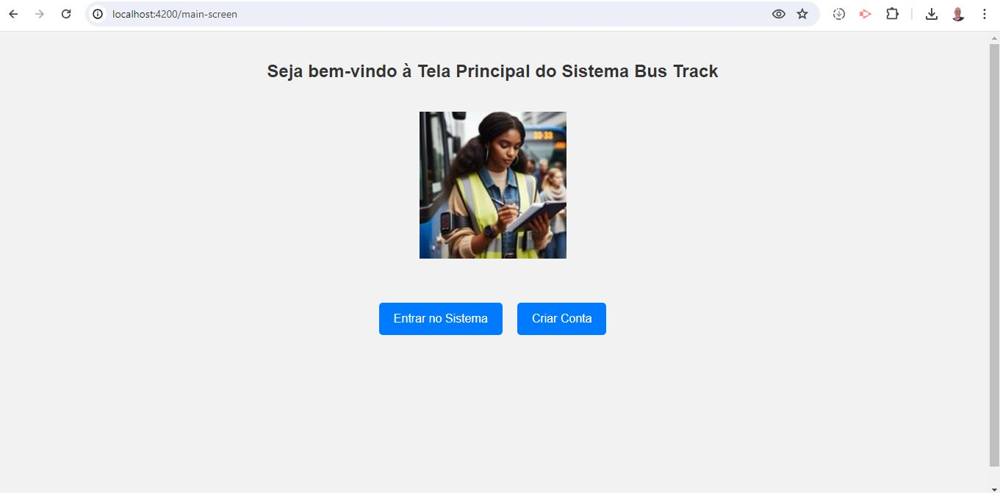
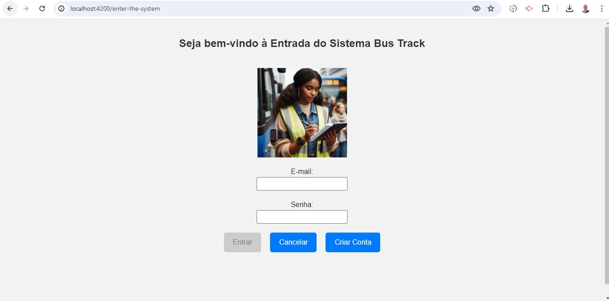
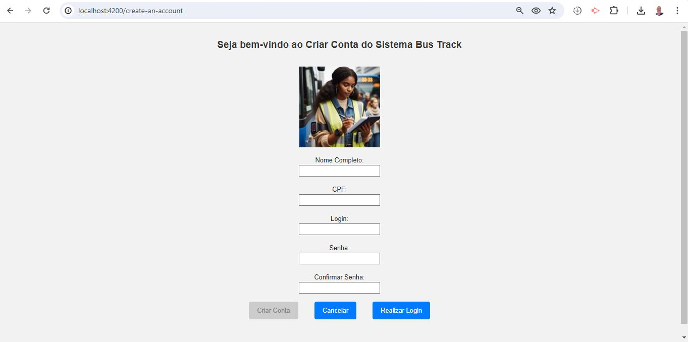
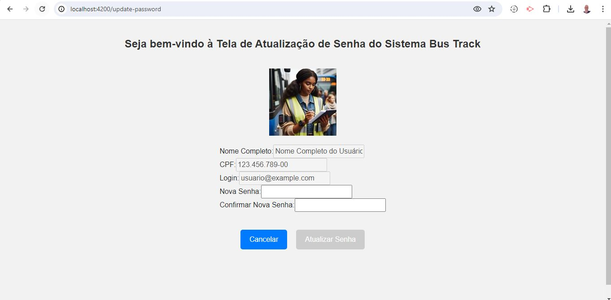
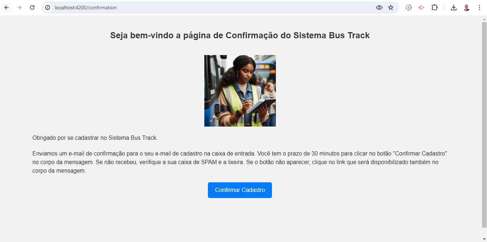
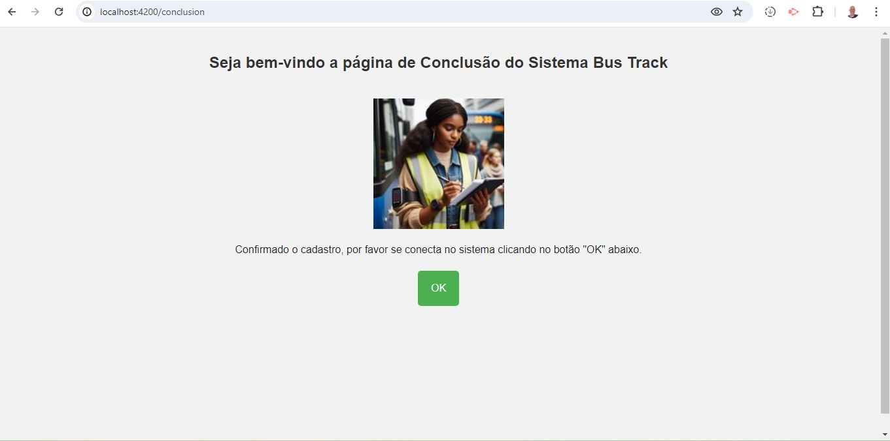
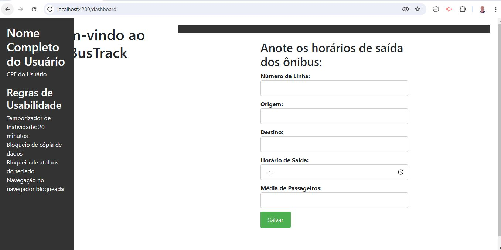

# Telas

Esta documentação apresenta as principais telas atualmente disponíveis no BusTrack.

## Autenticação

### Tela principal

Porta de entrada da aplicação.

### Tela de login

Permite autenticar um usuário existente.

### Tela de criação de conta

Permite cadastrar uma nova conta de usuário.

### Tela de recuperação de senha

A tela de solicitação está disponível, mas não representa um fluxo de recuperação pronto: o endpoint chamado pelo formulário é protegido para `ADMIN`, enquanto o endpoint público de solicitação ainda informa que a verificação segura não foi implementada. O componente de redefinição por código também não está registrado nas rotas revisadas.

### Tela de atualização de senha

Permite alterar a senha de uma conta autenticada.

### Tela de confirmação

Apresenta uma etapa de confirmação dos fluxos de autenticação que utilizam essa etapa.

### Tela de conclusão

Apresenta a conclusão de um fluxo de autenticação ou conta.

## Área autenticada

### Dashboard

Área principal após a autenticação. Apresenta a navegação e os recursos disponíveis conforme a role do usuário.

### Dashboard do usuário

Área destinada ao papel `USER`. A rota e o guard devem encaminhar o usuário ao dashboard correspondente ao papel autenticado.

### Dashboard administrativo

Área administrativa disponível para `ADMIN`, com indicadores, usuários, pesquisa, paginação e dados de presença.

### Ônibus

Tela de gerenciamento de ônibus.

### Motoristas

Tela de gerenciamento de motoristas.

### Rotas

Tela de gerenciamento de rotas.

### Passageiros

Tela de gerenciamento de passageiros.

### Viagens

Tela de gerenciamento de viagens.

### Manutenções

Tela de gerenciamento das manutenções dos ônibus. As regras de edição e exclusão dependem do papel autorizado e do status do registro.

### Detalhes da viagem

Tela destinada à consulta detalhada de uma viagem e suas relações.

## Observação sobre a V2

Login com Google, MFA/2FA, reCAPTCHA e eventual autenticação baseada em cookies não fazem parte das telas da V1 e estão planejados para uma evolução futura.
